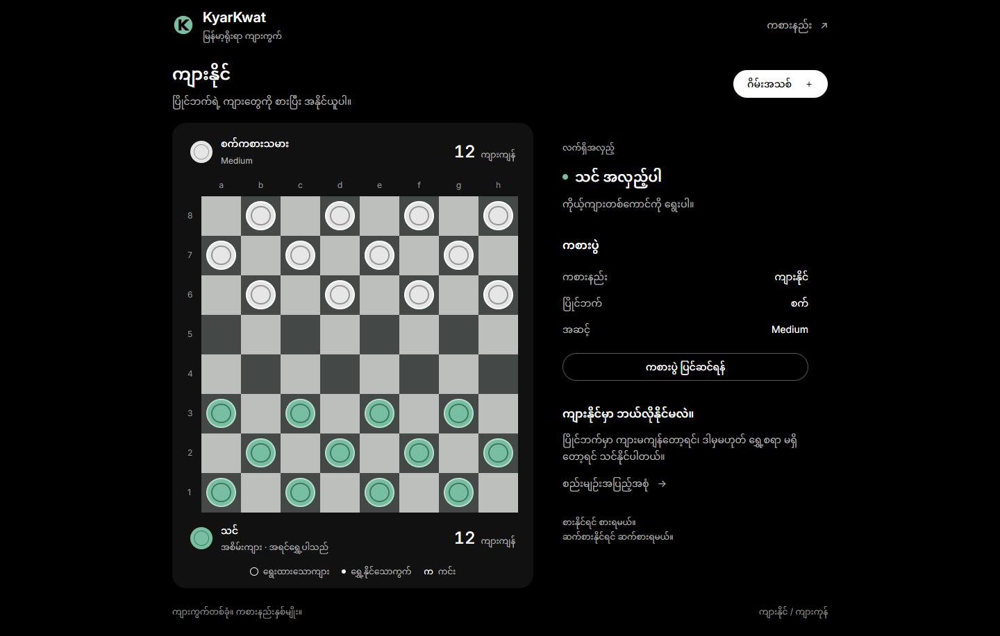
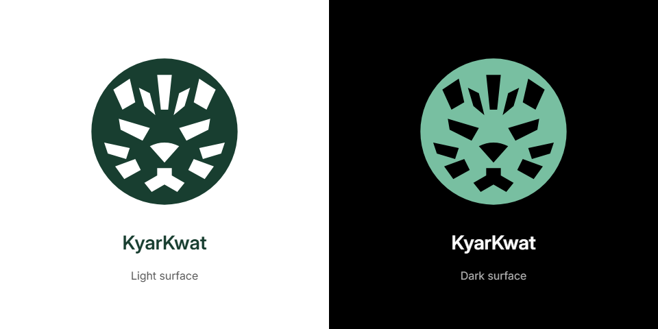

<p><a href="https://kyarkwat.vercel.app/"></a></p>

# Kyar Kwat — မြန်မာ့ရိုးရာ ကျားကွက်

**ကျားနိုင် / ကျားကုန်** ကစားနည်းနှစ်မျိုးကို ဖုန်းနဲ့ ကွန်ပျူတာ Browser ထဲမှာ ကစားနိုင်တဲ့ **.NET 10 Blazor WebAssembly Project** ပါ။ စက်နဲ့ **Easy / Medium / Hard** အဆင့်ရွေးကစားနိုင်သလို တစ်စက်တည်းမှာ နှစ်ယောက် အလှည့်ကျ ကစားနိုင်ပါတယ်။

[Burma Project Ideas](https://github.com/burma-project-ideas) အောက်မှာ ရိုးရာဂိမ်းရဲ့ စည်းမျဉ်း၊ Board State၊ Legal Move Generation နဲ့ Computer Search ကို လေ့လာပြီး ကိုယ်နှစ်သက်တဲ့ Language နဲ့ ပြန်ရေးကြည့်နိုင်ဖို့ ထားပေးထားတာပါ။

**[ဂိမ်းကို ဖွင့်ကစားရန်](https://kyarkwat.vercel.app/)** · [Mobile screenshot](docs/images/mobile.jpg) · [Development / Verification မှတ်တမ်း](docs/DEVELOPMENT.md)

[](https://kyarkwat.vercel.app/)

## ကစားနည်းနှစ်မျိုး

| Mode | အနိုင်ရမည့်အခြေအနေ |
| --- | --- |
| **ကျားနိုင်** | ပြိုင်ဘက်မှာ ကျားမကျန်တော့ရင်၊ ဒါမှမဟုတ် ပြိုင်ဘက် ရွှေ့စရာမရှိတော့ရင် ကိုယ်နိုင်ပါတယ်။ |
| **ကျားကုန်** | **ကိုယ့်ကျား တစ်ကောင်မှ မကျန်တော့ရင်၊ ဒါမှမဟုတ် ကိုယ်ရွှေ့စရာမရှိတော့ရင် ကိုယ်နိုင်ပါတယ်။** |

ကျားကုန်မှာ **Feed** ဆိုတာ ကိုယ့်ကျားကို ပြိုင်ဘက်စားနိုင်အောင် တရားဝင်ရွှေ့ကွက်နဲ့ ခင်းပေးတာပါ။ စားနိုင်ရင် မဖြစ်မနေစားရတဲ့ စည်းမျဉ်းက Mode နှစ်ခုလုံးမှာ အတူတူပါပဲ။

## အသုံးပြုပုံ

1. ကျားနိုင် / ကျားကုန်ကို ရွေးပါ။
2. စက်နဲ့ကစားမလား၊ နှစ်ယောက်ကစားမလား ရွေးပါ။ စက်နဲ့ဆို Easy / Medium / Hard ကို ရွေးနိုင်ပြီး Medium က မူလရွေးချယ်မှုပါ။
3. **စကစားမယ်** ကို နှိပ်ပါ။ တစ်ဖက်စီ ကျား ၁၂ ကောင်နဲ့ စပြီး အစိမ်းကျားက အရင်ရွှေ့ပါတယ်။
4. ကိုယ့်ကျားကို နှိပ်ပြီး ပြထားတဲ့ ရွှေ့နိုင်သောကွက်ကို နှိပ်ပါ။ ဆက်စားစရာရှိရင် အဲဒီကျားနဲ့ပဲ ဆက်စားပါ။
5. ရလဒ်မှာ အနိုင်ရသူနဲ့ အကြောင်းရင်းကို ကြည့်ပြီး **ထပ်ကစားမယ်** နဲ့ ပြန်စနိုင်ပါတယ်။

ဖုန်းမှာ Board အကွက်တစ်ခုလုံးကို နှိပ်နိုင်ပြီး Scroll နဲ့ Pinch Zoom ကို ဆက်သုံးနိုင်ပါတယ်။ Dialog ဖွင့်ထားချိန် နောက်ခံဂိမ်း မရွေ့ပါဘူး။ Keyboard နဲ့ဆို Tab၊ မြားခလုတ်များနဲ့ Enter/Space ကို သုံးနိုင်ပါတယ်။ Settings က ဂိမ်းအသစ် စမှသာ သက်ရောက်ပြီး Cancel/Escape က လက်ရှိဂိမ်းကို ထိန်းထားပါတယ်။

## အခြေခံစည်းမျဉ်းများ

- 8×8 ခုံရဲ့ ကစားနိုင်သောအကွက်တွေကိုပဲ အသုံးပြုပါတယ်။ ရိုးရိုးကျားက ရှေ့ထောင့်ဖြတ် တစ်ကွက် ရွှေ့နိုင်ပြီး ရှေ့ဘက်ကို ခုန်စားနိုင်ပါတယ်။
- စားနိုင်ရင် မဖြစ်မနေစားရပါတယ်။ လမ်းကြောင်းများရင် **အများဆုံးစားနိုင်သော လမ်းကြောင်းအပြည့်** ကို ရွေးရပြီး တူညီတဲ့လမ်းတွေထဲက ရွေးနိုင်ပါတယ်။
- ဆက်စားနိုင်သေးရင် ဆက်စားရပါတယ်။ စားပြီးသောကျားတွေကို အလှည့်အဆုံးမှ ဖယ်ပြီး အဲဒီအချိန်မတိုင်ခင် လမ်းပိတ်နေဆဲ ဖြစ်ပါတယ်။
- အလှည့်အဆုံးမှာ တစ်ဖက်အစွန်ရောက်ရင် **ကင်း** ဖြစ်ပါတယ်။ ကင်းက ရှေ့နောက် ထောင့်ဖြတ်အတိုင်း အဝေးရွှေ့၊ အဝေးစားနိုင်ပါတယ်။
- ကျားမစားဘဲ ကင်းသာ တစ်ဖက်စီ ၂၅ ကြိမ် ဆက်တိုက်ရွှေ့ရင် သရေပါ။ ကျားစားခြင်း သို့မဟုတ် ရိုးရိုးကျားရွှေ့ခြင်းက အဲဒီ Counter ကို ပြန်စပါတယ်။ အနိုင်ရခြင်းက သရေစစ်ခြင်းထက် ဦးစားပေးပါတယ်။

## App ရဲ့ Workflow

1. `Program.cs` က Blazor App ကို စတင်ပြီး `Home.razor` က Board၊ Setup၊ Status နဲ့ Result ကို ပြပါတယ်။
2. `GameRules.NewGame` က မူလခုံကို တည်ဆောက်ပါတယ်။ `GameState` မှာ Board၊ အလှည့်၊ Mode၊ Legal Moves နဲ့ Result ကို သိမ်းပါတယ်။
3. `GameRules` က တစ်ခုံလုံးရဲ့ Capture Routes တွေကို တွက်ပြီး အများဆုံးစားနိုင်တဲ့ လမ်းတွေကိုပဲ ခွင့်ပြုပါတယ်။ Capture မရှိမှ ပုံမှန်ရွှေ့ကွက်တွေကို ခွင့်ပြုပါတယ်။
4. UI က တစ်ဆင့်ချင်း ရွေးခွင့်ပေးပေမယ့် Engine က အလှည့်အပြည့်ကို ပြန်စစ်ပြီး Board Snapshot အသစ်အဖြစ် Apply လုပ်ပါတယ်။
5. Promotion၊ Draw Counter၊ နောက်အလှည့်နဲ့ Mode အလိုက် အနိုင်အရှုံးကို စစ်ပါတယ်။
6. စက်အလှည့်မှာ `ComputerPlayer` က အဲဒီ Legal Moves တွေကိုပဲ သုံးပြီး Minimax / Alpha-beta Search လုပ်ပါတယ်။ ဂိမ်းအသစ်စရင် အရင် Search ကို Cancel လုပ်ပြီး အဟောင်းရလဒ် မသက်ရောက်အောင် စစ်ပါတယ်။

Game State နဲ့ AI က Browser ထဲမှာပဲ အလုပ်လုပ်ပါတယ်။ Account၊ Database နဲ့ Gameplay API မလိုပါဘူး။ `game-ui.js` က Dialog နဲ့ Keyboard Focus အတွက်ပဲဖြစ်ပြီး JavaScript Game Engine သီးသန့် မရှိပါဘူး။

| AI Level | ကြိုတွက်မည့် အလှည့်အများဆုံး | Search Node Budget |
| --- | ---: | ---: |
| Easy | 1 | 500 |
| Medium | 3 | 5,000 |
| Hard | 5 | 25,000 |

ဆက်တိုက်စားခြင်းတစ်ခုလုံးကို အလှည့်တစ်လှည့်အဖြစ် တွက်ပါတယ်။ Level မြင့်တာက ပိုကြိုတွက်ခြင်းဖြစ်ပြီး Expert အဆင့်ဖြစ်ကြောင်း၊ အမြဲနိုင်ကြောင်း အာမခံချက် မဟုတ်ပါဘူး။

## Project ဖွဲ့စည်းပုံ

| Path | တာဝန် |
| --- | --- |
| `BlazorWasm.KyarKwat/Models/GameState.cs` | Board Snapshot၊ Piece၊ Mode၊ Move နဲ့ Result |
| `BlazorWasm.KyarKwat/Services/GameRules.cs` | Legal Routes၊ Validation၊ Capture၊ Promotion နဲ့ အနိုင်အရှုံး |
| `BlazorWasm.KyarKwat/Services/ComputerPlayer.cs` | Level အလိုက် Search၊ Cancellation နဲ့ Node Budget |
| `BlazorWasm.KyarKwat/Pages/Home.razor*` | UI၊ Interaction၊ State Lifecycle နဲ့ Responsive CSS |
| `BlazorWasm.KyarKwat/wwwroot/` | Static Assets၊ Fonts နဲ့ Dialog/Focus Helper |
| `tests/` | C# Assertions၊ Browser Regression နဲ့ Touch Checks |
| `scripts/Prepare-Vercel.ps1` | Publish နဲ့ Vercel Output ပြင်ဆင်ခြင်း |
| `specs/001-kyarkwat/` | Specification၊ Plan နဲ့ Tasks |
| `design/` | အတည်ပြုထားသော Design / Flow Prototype |

## Local မှာ Run မယ်

`global.json` မှာ သတ်မှတ်ထားတဲ့ **.NET SDK 10.0.302** သို့မဟုတ် compatible patch လိုပါတယ်။

```sh
git clone https://github.com/burma-project-ideas/kyar-kwat.git
cd kyar-kwat
dotnet restore BlazorWasm.KyarKwat
dotnet run --project BlazorWasm.KyarKwat -c Release --urls http://127.0.0.1:5280
```

Browser မှာ [http://127.0.0.1:5280](http://127.0.0.1:5280) ကို ဖွင့်ပါ။

## Build၊ စစ်ဆေးခြင်းနဲ့ Deployment

```sh
dotnet build BlazorWasm.KyarKwat -c Release
dotnet run --project tests/KyarKwat.Checks -c Release
dotnet publish BlazorWasm.KyarKwat -c Release -o artifacts/publish
```

Static Host မှာ `artifacts/publish/wwwroot/` ကို HTTP(S) နဲ့ Serve လုပ်ပါ။ Vercel အတွက် PowerShell 7 နဲ့ `./scripts/Prepare-Vercel.ps1` ကို Run ပြီး Project Link မှန်ကြောင်း စစ်ကာ `vercel deploy --prebuilt --prod` နဲ့ တင်နိုင်ပါတယ်။ လက်ရှိက Manual CLI Deployment ဖြစ်ပြီး Git Push ကနေ Auto-deploy မချိတ်ထားသေးပါဘူး။

C# Assertions **၁၀၀**၊ Browser Assertions **၁,၁၀၀** နဲ့ Touch Assertions **၃၄၂** စစ်ဆေးထားပါတယ်။ Touch Checks က အရွယ်ခြောက်မျိုး၊ Mode နှစ်ခု၊ Capture Chains၊ Replay နဲ့ AI Level သုံးမျိုးကို စစ်ပါတယ်။ တကယ့်ဖုန်းနဲ့ iOS Safari / Screen Reader ကိုတော့ မစမ်းသပ်ရသေးပါဘူး။ [အသေးစိတ်မှတ်တမ်း](docs/DEVELOPMENT.md) မှာ Commands နဲ့ Results ကို ကြည့်နိုင်ပါတယ်။

## ကိုယ်တိုင် ပြန်ရေးကြည့်ချင်ရင်

Board State → Legal Routes → Apply Turn → Result → Computer Search ဆိုတဲ့ Flow ကို အရင်ခွဲလေ့လာပါ။ UI မရေးခင် Compulsory Capture၊ Maximum Capture၊ ကင်း၊ ကျားကုန်အနိုင်အရှုံးနဲ့ Draw ကို Board Fixture တွေနဲ့ စစ်ကြည့်ပါ။ ကိုယ်နှစ်သက်တဲ့ Language / Platform နဲ့ ပြန်ရေးကြည့်နိုင်ပါတယ်။

## Logo နဲ့ Brand Assets

Logo အသစ်က ကျားအဝိုင်းထဲမှာ **K ပုံစံကို Transparent Cutout** အဖြစ် ရေးထားတဲ့ **Jump K counter** ပါ။ လက်ရှိ App ရဲ့ Mint Green / Black Palette နဲ့ လိုက်ဖက်ပြီး Light Surface အတွက် အစိမ်းရင့် Variant ပါရှိပါတယ်။



[Transparent SVG Master](BlazorWasm.KyarKwat/wwwroot/branding/logo-master.svg) · [Transparent PNG](BlazorWasm.KyarKwat/wwwroot/branding/logo-dark.png) · [Assets နဲ့ အသုံးပြုပုံ](docs/BRANDING.md)

Favicon 16/32/48၊ Apple Icon 180၊ App Icons 192/512၊ Maskable Icon နဲ့ Social Card 1200×630 တို့ကို Master တစ်ခုတည်းကနေ ထုတ်ထားပါတယ်။ Node 22+ နဲ့ Chrome/Edge ရှိရင် `node scripts/build-brand.mjs` နဲ့ ပြန်ထုတ်နိုင်ပါတယ်။ App က Dark Theme ဖြစ်ပြီး Logo Variant တွေကို Light/Dark Surface နှစ်မျိုးလုံးမှာ စစ်ထားပါတယ်။

## ပံ့ပိုးသူများနှင့် Credits

- App / Git Contributor: [Sann Lynn Htun](https://github.com/sannlynnhtun-coding)။ Project Collection: [Burma Project Ideas](https://github.com/burma-project-ideas)။
- စည်းမျဉ်းနဲ့ ကစားပုံ Reference: [ကျားကွက် — Myanmar Checkers](https://harryheinthant.site/checker)။ အဲဒီ Website ရဲ့ Source Code / Assets ကို App ထဲ ကူးမသုံးထားပါဘူး။
- UI: Black/Neutral Layout၊ အစိမ်း/အဖြူကျား၊ ကိုယ်ပိုင် SVG Mark နဲ့ CSS Counters။ Design ဆုံးဖြတ်ချက်တွေကို `design/` မှာ ကြည့်နိုင်ပါတယ်။
- Fonts: [Inter](https://github.com/google/fonts/tree/main/ofl/inter) နဲ့ [Noto Sans Myanmar](https://github.com/google/fonts/tree/main/ofl/notosansmyanmar)။ Font File နဲ့ SIL Open Font Licenses ကို `BlazorWasm.KyarKwat/wwwroot/fonts/` မှာ ထည့်ထားပါတယ်။
