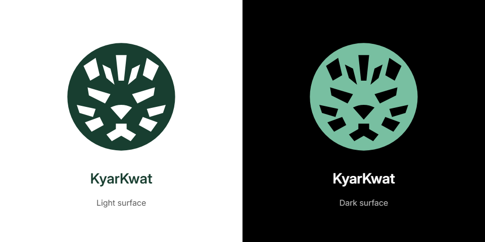

# KyarKwat branding

The **Tiger + Doe Pyar counter** combines a tiger face with the round Burmese draughts counter (ဒိုးပြား). Bold eyes, nose and stripes are transparent cutouts in one circular silhouette. It uses the existing app palette: mint `#78bfa1` on dark surfaces and deep green `#183e30` on light surfaces. The app itself remains dark-only.



## Master and generated assets

Edit [`logo-master.svg`](../BlazorWasm.KyarKwat/wwwroot/branding/logo-master.svg), then run:

```sh
node scripts/build-brand.mjs
```

Node 22+ and installed Chrome/Edge are required; `CHROME_PATH` can select the browser. No npm dependencies are added. The existing generator renders one transparent 96×96 SVG master into all sizes, checks PNG dimensions, JPEG signatures and transparent corners/forehead stripe, and writes:

| Asset in `wwwroot/branding/` | Purpose |
|---|---|
| `logo-master.svg` | Editable transparent vector master |
| `logo-dark.svg`, `logo-light.svg` | Transparent surface variants |
| `logo-dark.png`, `logo-light.png` | Transparent 1024×1024 exports |
| `favicon.svg` | Adaptive light/dark vector favicon |
| `favicon-16.png`, `favicon-32.png`, `favicon-48.png`, `favicon.ico` | Small icons and multi-resolution ICO |
| `apple-touch-icon.png` | 180×180 Apple icon |
| `icon-192.png`, `icon-512.png` | Standard app icons |
| `icon-maskable-512.png` | Opaque icon with padded safe area |
| `social-card-tiger.jpg` | Current 1200×630 JPEG share preview with bundled Burmese/Inter fonts |
| `social-card-tiger.png` | Previous PNG export, retained for already-shared image URLs |
| `social-card.png` | Compatibility alias, regenerated with the current design |

The root `/favicon.ico` and `docs/images/mark.svg` remain compatibility exports with the new geometry. The header, loader, prototype, favicon declarations and manifest use the generated assets. Updated icon URLs carry `?v=tiger`; Open Graph and Twitter use the absolute `social-card-tiger.jpg` URL to avoid reusing the old image cache key. Existing social messages can retain their own cached previews.

This is an original native SVG drawing, with no stock image or copied third-party logo. The Inter and Noto Sans Myanmar SIL licenses and original game-rules attribution remain unchanged.

## Verification — 2026-11-09

The generator checks 12 PNG exports, transparent cutouts, SVG variants and the 16/32/48 ICO. The brand check covers metadata served without JavaScript to Facebook/Telegram user agents, image MIME type and dimensions, manifest icons, root favicon parity, matching master geometry, header/loader rendering, 360/390px layouts, adaptive light/dark favicon and maskable safe area.

```sh
node tests/brand-checks.mjs "PATH_TO_DESIGN_SKILL" http://127.0.0.1:5281
node tests/brand-checks.mjs "PATH_TO_DESIGN_SKILL" https://kyarkwat.vercel.app
```

Browser screenshots are saved under ignored `.taste-skill/branding/`; README desktop/mobile screenshots are refreshed from the checked build. These automated user-agent requests test delivery, not either platform's preview renderer.

On 2026-11-09, actual Facebook Sharing Debugger navigation was attempted in the user's Chrome and the in-app browser. Navigation/capture timed out and no preview was obtained. Telegram Desktop input reported unavailable coordinate geometry and window capture timed out; no preview was observed during that inspection. The platform recheck below supersedes that Telegram limitation.

For a manual platform recheck, use [Facebook Sharing Debugger](https://developers.facebook.com/tools/debug/?q=https%3A%2F%2Fkyarkwat.vercel.app%2F), then **Scrape Again**. For Telegram, [its official preview-update guidance](https://bugs.telegram.org/c/57/4) describes submitting the public URL to [@WebpageBot](https://t.me/WebpageBot). Verify the returned image visually; a cache-refresh success message alone does not prove rendering.

Physical iOS/Android devices and installed home-screen icons are not checked. This branding release does not change game rules, AI, themes or offline behavior.

Production: [kyarkwat.vercel.app](https://kyarkwat.vercel.app/), deployment dpl_RaN2Dq794mqDy9HQEDkUfwHUAbqi (READY). The live share image SHA-256 matches the locally generated Tiger + Doe Pyar export.

Results: 70 brand assertions passed locally and on production. Generated preview pixels were inspected on light/dark surfaces; the live preview matches the local export byte for byte. Build and static-file hash verification passed. Gameplay regression suites were not rerun for this asset-only change.

## Actual platform recheck — 2026-11-10

With the user's help opening Telegram Desktop's **Webpage Bot** chat and sending the prepared test URL, its actual returned message was inspected through the accessibility tree:

| URL | Actual bot result |
|---|---|
| `https://kyarkwat.vercel.app/` | Plain URL, even after the bot reported a successful update at 00:10 Myanmar time |
| `https://kyarkwat.vercel.app/?preview=tiger-20261110` | Photo, **1200×630**; website **KyarKwat**; title **KyarKwat — ကျားနိုင် / ကျားကုန်**; Burmese description, returned at 00:10 Myanmar time |

The earlier workaround was [the verified query URL](https://kyarkwat.vercel.app/?preview=tiger-20261110) when sharing on Telegram. It opens the same game. The root-specific failure with a successful fresh query strongly suggests stale URL state in Telegram; it is an inference, not a confirmed internal cache diagnosis. Similar root/query behavior is reported on [Telegram's issue tracker](https://bugs.telegram.org/c/61650/31). A Webpage Bot success message alone did not repair the exact root URL.

The live page still declares the Tiger + Doe Pyar PNG in static Open Graph/Twitter metadata. That PNG returns HTTP 200, `image/png`, 54,349 bytes. Vercel's read-only firewall configuration returned `active: null`, `draft: null`, and no custom versions; no firewall settings were changed. This does not establish whether platform-wide filtering ever occurred.

Photo presence, dimensions and text were confirmed from the actual Telegram message. Screenshot capture still timed out, so its rendered logo pixels were not independently inspected. Facebook Sharing Debugger and Facebook's share dialog both returned browser `ERR_CONNECTION_TIMED_OUT`; their actual preview remains unverified. No metadata or image defect was established by these results, so the working metadata/image assets are unchanged.

## Unchanged-root JPEG retry — 2026-11-10

At the user's request, the shared URL and canonical URL remain exactly `https://kyarkwat.vercel.app/`; no redirect or query parameter was introduced. The single-master generator now also exports a 1200×630 JPEG at quality 0.92. Both Open Graph and Twitter reference `social-card-tiger.jpg`, and `og:image:type` is `image/jpeg`. Existing PNG URLs remain available for previously shared messages.

Production deployment `dpl_9QjNBDHM1UAEKfooHdnByY8QAJWs` is READY. The JPEG returns HTTP 200, `image/jpeg`, 36,234 bytes; browser decoding confirms 1200×630. The build/static-copy verification and 74 local and 74 production branding assertions passed. This was a compatibility/cache-revalidation experiment, not a confirmed PNG defect: the previous PNG already worked with a fresh page-query URL.

After deployment the user sent the exact root URL to Webpage Bot again. At **00:19 Myanmar time**, Telegram reported a successful refresh, but the actual returned message was still a plain root link, with no photo/title/description in its accessibility tree. **The JPEG retry did not fix the root preview.** Screenshot capture remains unavailable. No game logic or security settings were changed. The README now gives only the requested clean root URL instead of recommending a query-parameter workaround.

The remaining root-specific preview state cannot be invalidated through an exposed website setting or a verified Telegram operation available in this session. Further investigation needs Telegram's preview backend/support; changing more metadata without evidence would not establish a fix. [Telegram's own guidance](https://bugs.telegram.org/c/57/4) directs persistent preview problems to in-app support after a Webpage Bot refresh.
